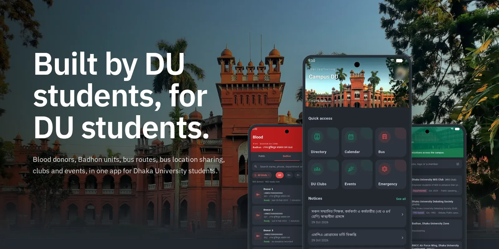
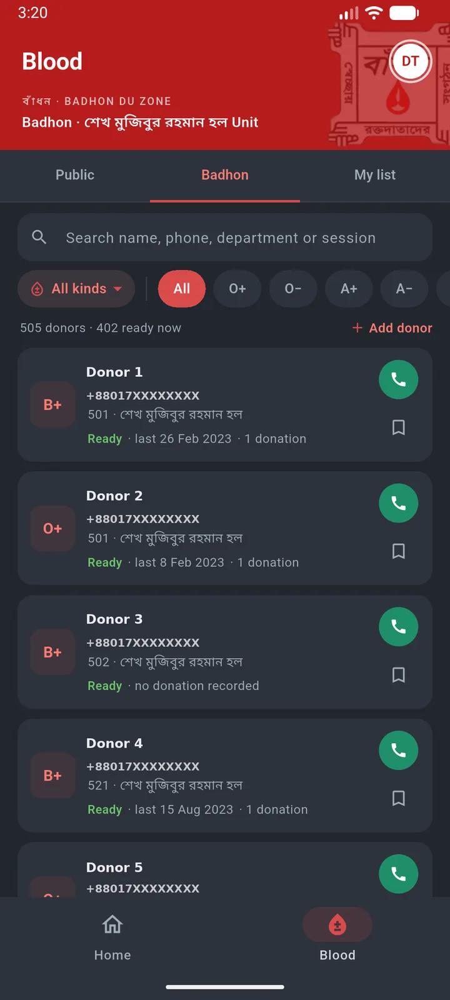
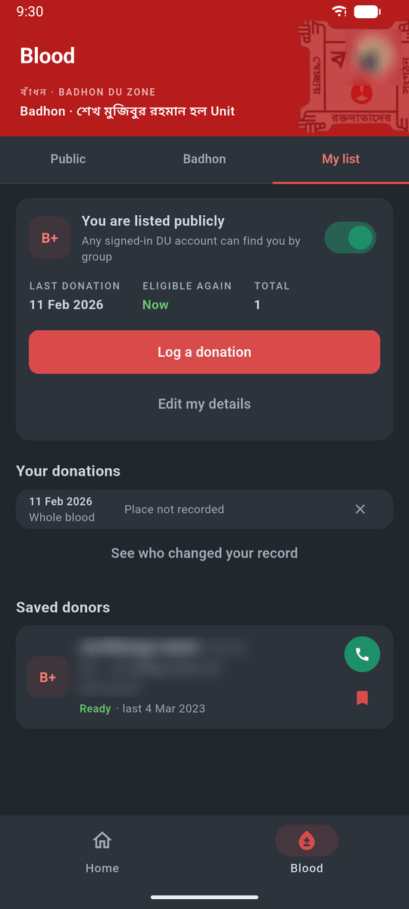
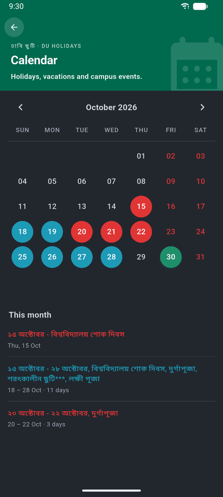
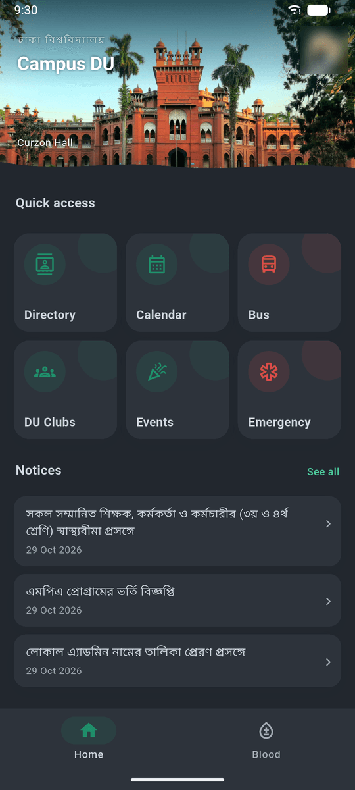
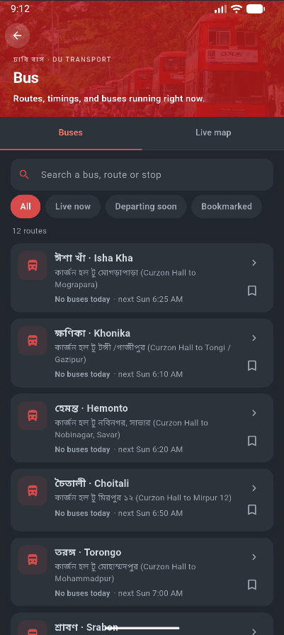
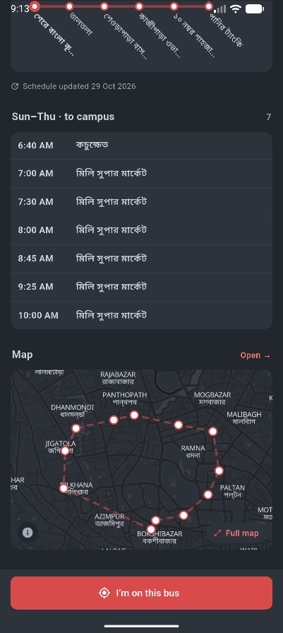
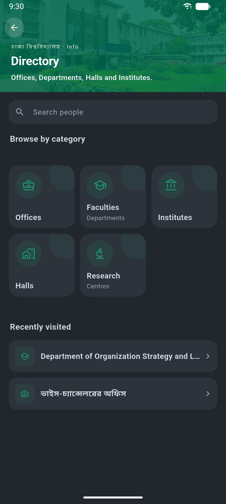

  

<h1 align="center">Campus DU</h1>

  <b>Built by DU students, for DU students.</b> 

  

  
  
  

## What’s inside

<table>
  <tr>
    <td width="25%" valign="top">
      
      
<b>Badhon list</b>

    </td>
    <td width="25%" valign="top">
      
      
<b>Donor Status</b>

    </td>
    <td width="25%" valign="top">
      
      
<b>Calendar</b>

    </td>
    <td width="25%" valign="top">
      
      
<b>Home</b>

    </td>
  </tr>
  <tr>
    <td width="25%" valign="top">
      
      
<b>Buses</b>

    </td>
    <td width="25%" valign="top">
      
      
<b>Routes</b>

    </td>
    <td width="25%" valign="top">
      
      
<b>Clubs and events</b>

    </td>
    <td width="25%" valign="top">
      
      
<b>Directory</b>

    </td>
  </tr>
</table>

## Install

1. **Download** [`campus-du.apk`](https://github.com/caliburanime/campus-du-releases/releases/latest/download/campus-du.apk) on your Android phone.
2. **Allow the install.** Campus DU isn’t on the Play Store, so Android asks once whether your browser may install apps. Choose *Settings*, turn on *Allow from this source*, then go back.
3. **If Play Protect warns you,** scan it then install or choose *More details*, then *Install anyway*.
4. **Open it.** Browse straight away, or sign in with your `@du.ac.bd` Google account for the parts that need one, like the donor list.

From then on the app updates itself: it tells you when a new version is ready.

Which file should I download?

Each release has three APKs. If you’re not sure, take `campus-du.apk`, which works on every Android phone.

| File | For |
| --- | --- |
| `campus-du.apk` | Any phone (about 36 MB) |
| `campus-du-<version>-arm64-v8a.apk` | Most phones from the last few years (smaller) |
| `campus-du-<version>-armeabi-v7a.apk` | Older 32-bit phones (smaller) |

## The people behind it

Campus DU is made and kept up to date by students, in their own time.

<table>
  <tr>
    <td align="center" width="180" valign="top">
      <b>Calibur</b> 
      Developer 
      Designed and built Campus DU: the app, the website and the dashboard. 
      <a href="https://github.com/caliburanime">GitHub</a>
    </td>
    <td align="center" width="180" valign="top">
      <b>Delulu</b> 
      Clubs &amp; events 
      Keeps club pages and campus events up to date.
    </td>
    <td align="center" width="180" valign="top">
      <b>ZhongxiNa</b> 
      Buses 
      Keeps bus sechdule up to date.
    </td>
  </tr>
</table>
<b>Join us!</b>

## Found a problem?

Use **Help & feedback** in the app (from your account window). It reaches the team with your app version attached, so it’s the quickest way to get something fixed.

Not an official app of the University of Dhaka.

